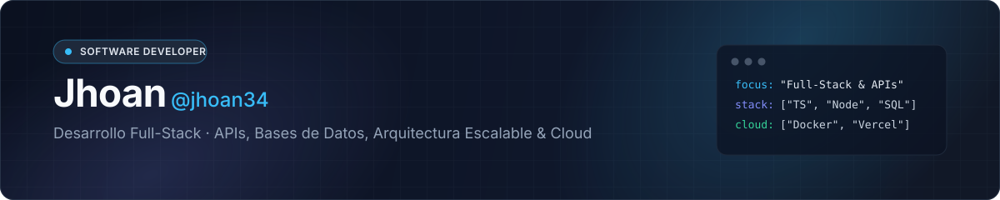

  

### Sobre mí

Soy desarrollador de software enfocado en construir aplicaciones web completas, APIs bien estructuradas y sistemas preparados para producción. Me interesa escribir código mantenible, cuidar la arquitectura de datos y adaptar las herramientas según lo que necesite cada proyecto — desde productos web modernos hasta backends con contenedores, integraciones con IA o servicios en la nube.

---

### Áreas de trabajo

| Área | Enfoque |
| :--- | :--- |
| **Frontend & Producto** | Interfaces responsivas, manejo de estado, validación de formularios, rendimiento y buena experiencia de usuario. |
| **Backend & APIs** | Diseño de APIs REST, autenticación y control de roles, webhooks, tareas programadas y arquitectura modular. |
| **Datos & Persistencia** | Modelado relacional (PostgreSQL) y NoSQL (MongoDB), ORMs (Prisma) y backends en tiempo real (Convex). |
| **Despliegue & Calidad** | Contenedores con Docker, despliegue continuo en Vercel/Render, variables de entorno y pruebas automatizadas. |

---

### Stack tecnológico

> Lista base de tecnologías con las que trabajo habitualmente (fácil de ampliar con nuevos stacks según cada proyecto).

  <strong>Lenguajes y Frontend</strong> 
  

  <strong>Backend, Bases de Datos e Infraestructura</strong> 
  

---

### Proyectos destacados

| Proyecto | Descripción | Stack |
| :--- | :--- | :--- |
| **[gestion_citas](https://github.com/jhoan34/gestion_citas)** | Sistema de reservas y gestión de citas con roles, proveedores, slots y despliegue en Docker/Render. | Express 5 · Prisma 7 · PostgreSQL · Clerk · Docker |
| **[asistenteestudiosssss](https://github.com/jhoan34/asistenteestudiosssss)** | Asistente de estudio con planes semanales, resúmenes, flashcards, quizzes con IA y tests en Vitest. | Next.js 16 · Convex · OpenAI · Vitest |
| **[inventory](https://github.com/jhoan34/inventory)** | Control de inventario por usuario con SKU, métricas visuales y alertas de stock bajo. | Next.js 16 · Prisma 7 · PostgreSQL · Stack Auth |
| **[dashboard](https://github.com/jhoan34/dashboard)** | Panel empresarial para administrar compañías, contactos y calendario de eventos. | Next.js 15 · MongoDB · Clerk · FullCalendar |
| **[soteos_pestas](https://github.com/jhoan34/soteos_pestas)** | Web comercial y sistema de sorteos con pasarela de pagos en producción. | Next.js 15 · MongoDB · MercadoPago · Clerk |
| **[proyectideas](https://github.com/jhoan34/proyectideas)** | Generador de ideas de proyectos impulsado por OpenAI y validación con Zod. | Next.js 16 · OpenAI · Framer Motion |

---

### Actividad en GitHub

  

---

<!--
  Cuando quieras agregar tus enlaces personales (LinkedIn, Portafolio, Correo),
  solo descomenta este bloque y reemplaza las URLs:

### Contacto

-->
